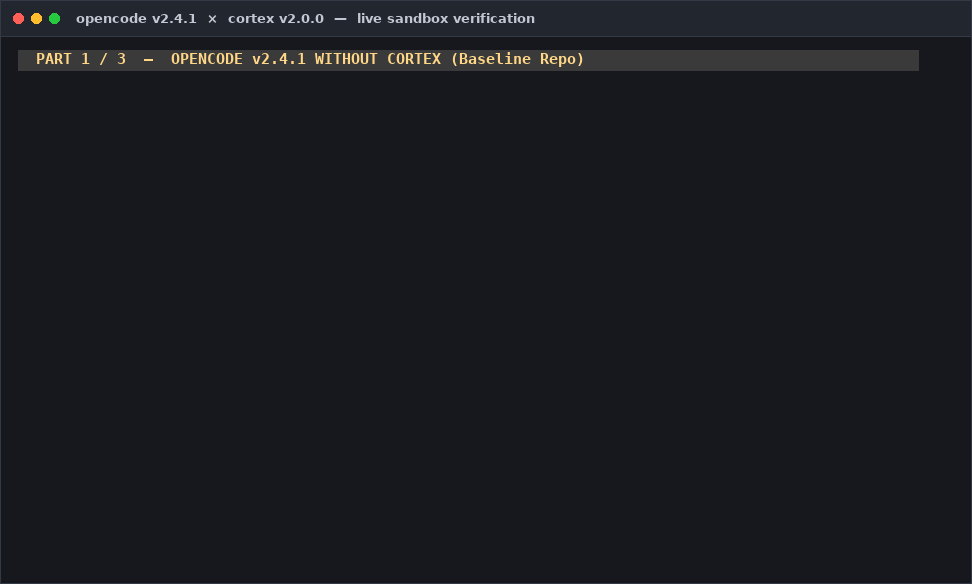

<div align="center">
  <a href="https://github.com/JovianOps/cortex">
    <picture>
      <source media="(prefers-color-scheme: dark)" srcset="assets/banner-dark.svg" />
      <source media="(prefers-color-scheme: light)" srcset="assets/banner-light.svg" />
      
    </picture>
  </a>

  <br />
  <br />

  <p>
    <a href="https://github.com/JovianOps/cortex/actions/workflows/ci.yml">
      
    </a>
    <a href="https://www.npmjs.com/package/@jovianops/cortex">
      
    </a>
    <a href="https://www.npmjs.com/package/@jovianops/cortex">
      
    </a>
    <a href="CHANGELOG.md">
      
    </a>
    <a href="#supported-agents--platforms">
      
    </a>
    <a href="#core-skills">
      
    </a>
    <a href="#extended-skills">
      
    </a>
    <a href="#verify-authenticity-sha-256--provenance">
      
    </a>
    <a href="LICENSE">
      
    </a>
  </p>

  <p>
    <a href="#whats-new-in-v200">What's New in v2.0.0</a>
<<<<<<< HEAD
    &nbsp;&middot;&nbsp;
    <a href="#proof-live-opencode-v241-before--after">Live Proof</a>
=======
>>>>>>> origin/main
    &nbsp;&middot;&nbsp;
    <a href="#quick-start">Quick Start</a>
    &nbsp;&middot;&nbsp;
    <a href="docs/mcp-guide.md">MCP Server</a>
    &nbsp;&middot;&nbsp;
    <a href="docs/studio-guide.md">Studio UI</a>
    &nbsp;&middot;&nbsp;
    <a href="docs/compiler-guide.md">Rule Compiler</a>
    &nbsp;&middot;&nbsp;
    <a href="docs/policy-and-sarif.md">SARIF Scanner</a>
    &nbsp;&middot;&nbsp;
    <a href="#verify-authenticity-sha-256--provenance">Verify SHA-256</a>
    &nbsp;&middot;&nbsp;
    <a href="CHANGELOG.md">Changelog</a>
  </p>
</div>

---

<<<<<<< HEAD
**Cortex `v2.0.0`** is the next-generation, zero-dependency AI-agent skill & runtime platform shipping **36 modular, deterministic Agent Skills (`SKILL.md`)** across **10 core skills** (`skills/`) and **26 extended engineering skills** (`premium-skills/`), with **36/36 bundled zero-dependency Python verifiers (100% coverage)**, a **native MCP 2025-03-26 JSON-RPC stdio server (`cortex mcp`)**, a **local Light/Dark Swiss Web Workbench (`cortex studio`)**, a **Universal Agent Rule Compiler (`cortex compile`)**, a **Unified Policy & SARIF 2.1.0 / JUnit XML Scanner (`cortex scan`)**, **10 curated Role-Based Skill Packs** (`packs.json`), **4 stable JSON Schemas (`schemas/`)**, **SHA-256 integrity verification (`checksums.json`, 72 bundled files + 36 ZIPs)**, and a **36-task live A/B benchmark harness**.
=======
**Cortex `v2.0.0`** is the next-generation, zero-dependency AI-agent skill & runtime platform shipping **36 modular, deterministic Agent Skills (`SKILL.md`)** across **10 core skills** (`skills/`) and **26 extended engineering skills** (`premium-skills/`), with **36/36 bundled zero-dependency Python verifiers (100% coverage)**, a **native MCP 2025-03-26 JSON-RPC stdio server (`cortex mcp`)**, a **local Light/Dark Swiss Web Workbench (`cortex studio`)**, a **Universal Agent Rule Compiler (`cortex compile`)**, a **Unified Policy & SARIF 2.1.0 / JUnit XML Scanner (`cortex scan`)**, **10 curated Role-Based Skill Packs** (`packs.json`), **4 stable JSON Schemas (`schemas/`)**, **SHA-256 integrity verification (`checksums.json`, 72 files)**, and a **36-task live A/B benchmark harness**.
>>>>>>> origin/main

Built on the open **`SKILL.md`** and **MCP** standards, Cortex works natively across **Visual Studio Code**, **GitHub Copilot**, **Claude** (Claude Code & Claude apps), **OpenAI** (Codex CLI & ChatGPT), **Gemini CLI**, **Cursor**, **Windsurf**, **OpenCode**, **OpenClaw**, **Goose**, **Aider**, **Cline**, and **Hermes Agent**.

## What's New in `v2.0.0`

<<<<<<< HEAD
- **Native Model Context Protocol Server (`cortex mcp`)**: Zero-dependency MCP 2025-03-26 JSON-RPC 2.0 stdio server exposing **8 tools**, **38 resources** (`cortex://skills/<slug>`, `cortex://packs`, `cortex://checksums`), and **36 invocable prompts** (`cortex/<slug>`), plus `--print-config <vscode|claude-code|cursor|codex|windsurf|opencode>`. See [docs/mcp-guide.md](docs/mcp-guide.md).
- **Cortex Studio Local Web Workbench (`cortex studio`)**: Zero-dependency Light/Dark Swiss local web UI & 10-endpoint REST API for inspecting all 36 skills and scripts, running any bundled verifier live against your workspace, compiling native agent rules, running SARIF scans, and generating MCP configs. See [docs/studio-guide.md](docs/studio-guide.md).
- **Universal Agent Rule Compiler (`cortex compile`)**: Deterministically transpiles `SKILL.md` playbooks into **7 native IDE/agent formats** — Cursor (`.cursor/rules/*.mdc`), VS Code (`.github/instructions/*.instructions.md`), Windsurf (`.windsurf/rules/*.md`), Cline (`.clinerules/*.md`), `CLAUDE.md`, `AGENTS.md`, and `GEMINI.md` — with `--dry-run` and `--check` CI drift verification. See [docs/compiler-guide.md](docs/compiler-guide.md).
- **Unified Policy & SARIF 2.1.0 Scanner (`cortex scan`)**: Orchestrates 14 bundled verifiers in one pass with `.cortex-policy.json` (`schemas/policy.schema.json`), severity gates (`--fail-on`), **SARIF 2.1.0** (GitHub Code Scanning), and **JUnit XML** output. See [docs/policy-and-sarif.md](docs/policy-and-sarif.md).
- **24 → 36 Skills, 36/36 Bundled Python Verifiers & 6 → 10 Role Packs**: Added 12 flagship extended skills (`kubernetes-architect`, `typescript-architect`, `rust-systems-engineer`, `go-backend-engineer`, `graphql-architect`, `llm-security-auditor`, `supply-chain-sbom`, `privacy-compliance-auditor`, `finops-cost-optimizer`, `chaos-resilience-engineer`, `architecture-decision-records`, `git-history-surgeon`) — all scoring **100.0/100** with paired 100-point A/B eval rubrics and 4 new packs (`cloud-native`, `ai-red-team`, `polyglot-systems`, `platform-architecture`).
- **Complete Technical Documentation (`docs/`)**: Added [architecture.md](docs/architecture.md), [mcp-guide.md](docs/mcp-guide.md), [studio-guide.md](docs/studio-guide.md), [compiler-guide.md](docs/compiler-guide.md), [policy-and-sarif.md](docs/policy-and-sarif.md), and [skill-authoring.md](docs/skill-authoring.md).

## Proof: Live OpenCode (`v2.4.1`) Before & After

Recorded live with `asciinema` against **[OpenCode](https://opencode.ai/) `v2.4.1` (`@opencode/cli`)** in two identical baseline repositories (containing unpinned GitHub Actions with `${{ github.event.head_commit.message }}` script injection, a hardcoded AWS key, raw SSN PII, and a privileged Kubernetes `latest` container) — **Without Cortex** vs. **With Cortex `v2.0.0`**:

<div align="center">
  
</div>

### Measured Before vs. After Verification

| Check / Capability | Without Cortex (Baseline Repo) | With Cortex `v2.0.0` | Live Proof Source |
| :--- | :--- | :--- | :--- |
| **OpenCode `v2.4.1` MCP status** (`opencode mcp list`) | `No MCP servers configured` | `✓ cortex  connected` | Live OpenCode CLI (`@opencode/cli@2.4.1`) |
| **Skills loaded by OpenCode** (`GET /api/skill`) | `3` built-in (`opencode`, `report`, `browser`) | `39` (`3` built-in + `36` Cortex `SKILL.md` playbooks in `.opencode/skills/`) | Live OpenCode HTTP API (`/api/skill`) |
| **MCP tools, resources & prompts** (`GET /api/mcp/resource`) | `0` tools · `0` resources · `0` prompts | `8` workspace-confined tools · `38` MCP resources · `36` prompts | Live OpenCode MCP stdio server |
| **Cross-IDE compiled rules** (`cortex compile`) | `0` rule files (`AGENTS.md` absent) | `AGENTS.md` + `.cursor/rules/*.mdc` + `.github/instructions/*.instructions.md` (`43` files across all packs in `76.7 ms`, `0` drift) | `cortex compile` |
| **Pre-flight security & ops gate** (`cortex scan . --fail-on high`) | `0` automated checks | `14` scanners · `20` findings (`CRIT=4`, `HIGH=6`, `MED=7`, `LOW=3`) · `Gate: FAIL` · **`0` false positives** across `.opencode/skills/` | `cortex scan` (`actions`, `secrets/CWE-798`, `kubernetes`, `pii`, ...) |
| **OpenCode `v1.19.6` (`opencode-ai`) parity** | `1` skill · `0` MCP (`515.4 ms` discovery) | `37` skills · `1` connected MCP (`454.1 ms` discovery) | Isolated v1 CLI A/B check |
| **Static skill & eval suite integrity** (`eval_skills.py`) | — | `36/36` skills scoring `100.0/100` · `36/36` paired A/B eval rubrics | `python scripts/eval_skills.py` |

> [!NOTE]
> **Verification scope & transparency**: Inside the isolated CI/build sandbox, outbound HTTPS traffic to external LLM inference providers fails with `ECONNRESET`, so cloud model chat replies (`opencode run "..."`) could not be invoked here. Every output in [`assets/cortex-opencode-proof.gif`](assets/cortex-opencode-proof.gif) comes from live local runs of **OpenCode `v2.4.1`**, its HTTP runtime endpoints (`/api/skill`, `/api/mcp`, `/api/mcp/resource`), **`cortex mcp`**, **`cortex compile`**, and **`cortex scan`**. Run full live cloud-LLM A/B reply scoring in your environment via `python scripts/eval_skills.py --run`.

<details>
<summary><strong>Reproduce this OpenCode + Cortex setup in 30 seconds</strong></summary>

```bash
# 1. Install all 36 Cortex SKILL.md playbooks + bundled verifiers into .opencode/skills/
python scripts/cortex.py install --agent opencode --collection all --scope project

# 2. Compile cross-agent rules (AGENTS.md + Cursor/VS Code/Windsurf/Cline/CLAUDE/GEMINI)
python scripts/cortex.py compile --target agents --target cursor --target vscode --pack cloud-native

# 3. Register Cortex MCP 2025-03-26 server in OpenCode (or use `cortex mcp --print-config opencode`)
opencode mcp add cortex -- npx -y @jovianops/cortex mcp

# 4. Reload OpenCode & verify live MCP connection + 14-scanner security gate
opencode reload && opencode mcp list
python scripts/cortex.py scan . --fail-on high
```

</details>
=======
- **Native Model Context Protocol Server (`cortex mcp`)**: Zero-dependency MCP 2025-03-26 JSON-RPC 2.0 stdio server exposing **8 tools**, **38 resources** (`cortex://skills/<slug>`, `cortex://packs`, `cortex://checksums`), and **36 invocable prompts** (`cortex/<slug>`), plus `--print-config <vscode|claude-code|cursor|codex|windsurf>`. See [docs/mcp-guide.md](docs/mcp-guide.md).
- **Cortex Studio Local Web Workbench (`cortex studio`)**: Zero-dependency Light/Dark Swiss local web UI & 10-endpoint REST API for inspecting all 36 skills and scripts, running any bundled verifier live against your workspace, compiling native agent rules, running SARIF scans, and generating MCP configs. See [docs/studio-guide.md](docs/studio-guide.md).
- **Universal Agent Rule Compiler (`cortex compile`)**: Deterministically transpiles `SKILL.md` playbooks into **7 native IDE/agent formats** — Cursor (`.cursor/rules/*.mdc`), VS Code (`.github/instructions/*.instructions.md`), Windsurf (`.windsurf/rules/*.md`), Cline (`.clinerules/*.md`), `CLAUDE.md`, `AGENTS.md`, and `GEMINI.md` — with `--check` CI drift verification. See [docs/compiler-guide.md](docs/compiler-guide.md).
- **Unified Policy & SARIF 2.1.0 Scanner (`cortex scan`)**: Orchestrates 14 bundled verifiers in one pass with `.cortex-policy.json` (`schemas/policy.schema.json`), severity gates (`--fail-on`), **SARIF 2.1.0** (GitHub Code Scanning), and **JUnit XML** output. See [docs/policy-and-sarif.md](docs/policy-and-sarif.md).
- **24 → 36 Skills, 36/36 Bundled Python Verifiers & 6 → 10 Role Packs**: Added 12 flagship extended skills (`kubernetes-architect`, `typescript-architect`, `rust-systems-engineer`, `go-backend-engineer`, `graphql-architect`, `llm-security-auditor`, `supply-chain-sbom`, `privacy-compliance-auditor`, `finops-cost-optimizer`, `chaos-resilience-engineer`, `architecture-decision-records`, `git-history-surgeon`) — all scoring **100.0/100** with paired 100-point A/B eval rubrics and 4 new packs (`cloud-native`, `ai-red-team`, `polyglot-systems`, `platform-architecture`).
- **Complete Technical Documentation (`docs/`)**: Added [architecture.md](docs/architecture.md), [mcp-guide.md](docs/mcp-guide.md), [studio-guide.md](docs/studio-guide.md), [compiler-guide.md](docs/compiler-guide.md), [policy-and-sarif.md](docs/policy-and-sarif.md), and [skill-authoring.md](docs/skill-authoring.md).
>>>>>>> origin/main

## Quick Start

Install into any agent in one command using the **Cortex CLI**, universal **Agent Skills CLI (`npx skills`)**, zero-clone **Python `--remote`** (with SHA-256 verification), or your agent's native plugin marketplace / tap:

```bash
# Cortex Unified CLI via npm (no git clone needed — detect agents, verify SHA-256, install role packs, start MCP/Studio)
npx @jovianops/cortex detect
npx @jovianops/cortex doctor
npx @jovianops/cortex packs
npx @jovianops/cortex install --agent opencode --pack cloud-native --scope project
npx @jovianops/cortex compile --target agents --pack fullstack
npx @jovianops/cortex scan . --fail-on high
npx @jovianops/cortex studio
npx @jovianops/cortex mcp

# Or install globally: npm install -g @jovianops/cortex  (then run `cortex detect`, `cortex mcp`, ...)

# Universal Agent Skills CLI (Claude Code, Codex, Gemini CLI, Cursor, Copilot, OpenCode, OpenClaw, Goose, Cline...)
npx skills add JovianOps/cortex

# Install a single skill globally for specific agents
npx skills add JovianOps/cortex --skill security-auditor -a claude-code -a cursor -g
```

```bash
# Zero-clone Python remote install with a Role Pack (no git clone, no Node.js — verifies SHA-256 via checksums.json)
curl -fsSL https://raw.githubusercontent.com/JovianOps/cortex/main/scripts/install_skills.py | python3 - --remote --agent claude-code --pack fullstack
```

```powershell
# Windows PowerShell zero-clone remote install (SHA-256 verified)
irm https://raw.githubusercontent.com/JovianOps/cortex/main/scripts/install_skills.py | python - --remote --agent claude-code --pack fullstack
```

```bash
# Hermes Agent native tap
hermes skills tap add JovianOps/cortex
hermes skills install JovianOps/cortex/skills/academic-assistant --yes
```

> [!TIP]
> Prefer a visual picker? Open [`index.html`](index.html) locally or via GitHub Pages to filter all **36 skills** and **10 role packs**, pick your target agent, and assemble a custom Bash or PowerShell install command with one click — or run `npx @jovianops/cortex studio` for the full local Light/Dark Swiss web workbench.

## Supported Agents & Platforms

Cortex ships 9 validated native manifests, a zero-dependency multi-agent manager, a Universal Rule Compiler (`cortex compile`), a native MCP stdio server (`cortex mcp`), and upload-ready ZIPs (`<slug>/SKILL.md` + bundled `scripts/`) so every major AI coding agent, IDE, and chat app works out of the box:

| Platform | Native Manifest / Format | Fast Install / Setup | Local Skills Directory |
| :--- | :--- | :--- | :--- |
| **Claude Code** | `.claude-plugin/marketplace.json` + `CLAUDE.md` | `/plugin marketplace add JovianOps/cortex` then `/plugin install cortex@cortex` — or `npx skills add JovianOps/cortex -a claude-code` | `~/.claude/skills/` · `.claude/skills/` |
| **Claude Apps** (claude.ai & Desktop) | Multi-file `<slug>/SKILL.md` ZIPs (`zips/`, `premium-zips/`) | Enable **Code execution** in **Settings → Capabilities**, then **Customize → Skills → Add → Upload skill** and upload any ZIP | Account-synced (web, desktop & mobile) |
| **OpenAI Codex CLI** | `.agents/plugins/marketplace.json` + `plugin.json` + `AGENTS.md` | `npx skills add JovianOps/cortex -a codex` or import `JovianOps/cortex` via Codex plugin marketplace | `~/.codex/skills/` · `.agents/skills/` |
| **ChatGPT** (Web & Desktop) | `SKILL.md` playbooks & `.agents/plugins/marketplace.json` | Upload any `SKILL.md` or ZIP to **ChatGPT Projects** (Project files / instructions) or **Custom GPTs**, or load via ChatGPT Desktop plugins | Project / Custom GPT knowledge |
| **Gemini CLI** | `gemini-extension.json` + `GEMINI.md` | `gemini extensions install https://github.com/JovianOps/cortex` or `npx skills add JovianOps/cortex -a gemini-cli` | `~/.gemini/skills/` · `.gemini/skills/` |
| **Cursor** | `.cursor-plugin/marketplace.json` + `.cursor/rules/*.mdc` | Import `https://github.com/JovianOps/cortex` in **Customize → Plugins**, or `npx skills add JovianOps/cortex -a cursor` | `~/.cursor/skills/` · `.cursor/skills/` |
| **Visual Studio Code** | `.github/plugin/marketplace.json` + `.github/instructions/*.instructions.md` | Add `"JovianOps/cortex"` to `chat.plugins.marketplaces` (with `chat.plugins.enabled: true`) & browse `@agentPlugins`, or run `npx @jovianops/cortex install --agent vscode --pack fullstack --scope project --write-vscode-settings` | `~/.copilot/skills/` · `.github/skills/` |
| **GitHub Copilot** | `.github/plugin.json` + `plugin.json` | `npx @jovianops/cortex install --agent copilot --pack fullstack --scope project` or `npx skills add JovianOps/cortex -a github-copilot` | `~/.copilot/skills/` · `.github/skills/` |
| **Windsurf** | `SKILL.md` + `.windsurf/rules/*.md` | `python scripts/cortex.py install --agent windsurf --pack fullstack` & `cortex mcp --print-config windsurf` | `~/.codeium/windsurf/skills/` · `.windsurf/skills/` |
| **OpenCode** | `SKILL.md` + `AGENTS.md` + `opencode.json` MCP | `python scripts/cortex.py install --agent opencode --collection all --scope project` & `cortex mcp --print-config opencode` | `~/.config/opencode/skills/` · `.opencode/skills/` |
| **OpenClaw** | `SKILL.md` + ZIP packages | `npx skills add JovianOps/cortex -a openclaw`, `python scripts/install_skills.py --agent openclaw`, or unzip `zips/*.zip` into `~/.openclaw/skills/` | `~/.openclaw/skills/` · `.openclaw/skills/` |
| **Goose** | `SKILL.md` | `npx skills add JovianOps/cortex -a goose` or `python scripts/install_skills.py --agent goose` | `~/.config/goose/skills/` · `.goose/skills/` |
| **Aider** | `SKILL.md` + `--read` / `.aider.conf.yml` | `python scripts/install_skills.py --agent aider --scope project --write-aider-conf` or `aider --read skills/<slug>/SKILL.md` | `~/.aider/skills/` · `.aider/skills/` |
| **Cline** | `SKILL.md` + `.clinerules/*.md` | `npx skills add JovianOps/cortex -a cline` or `python scripts/install_skills.py --agent cline --scope project` | `~/.cline/skills/` · `.cline/skills/` |
| **Hermes Agent** | Native Cortex tap | `hermes skills tap add JovianOps/cortex` then `hermes skills install JovianOps/cortex/<dir>/<slug> --yes` | Managed by `hermes skills` |

## Core Skills

Ten foundational skills located in [`skills/`](skills/) — every skill ships a deterministic zero-dependency Python verifier in `scripts/` and a reproducible ZIP archive in [`zips/`](zips/).

| Skill | Focus | Description | Bundled Tool | Spec | ZIP |
| :--- | :--- | :--- | :---: | :---: | :---: |
| **[academic-assistant](skills/academic-assistant)** | Academic & Multi-Domain | Orchestrate grading, coding, and 3D academic workflows | [`citation_check.py`](skills/academic-assistant/scripts/citation_check.py) | [`SKILL.md`](skills/academic-assistant/SKILL.md) | [`.zip`](zips/academic-assistant.zip) |
| **[anti-hallucination](skills/anti-hallucination)** | Verification | Verify AI claims and code with deterministic audit gates | [`verify_claims.py`](skills/anti-hallucination/scripts/verify_claims.py) | [`SKILL.md`](skills/anti-hallucination/SKILL.md) | [`.zip`](zips/anti-hallucination.zip) |
| **[blender-3d-modeling](skills/blender-3d-modeling)** | 3D & Graphics | Build and validate Blender 3D meshes with `bmesh` checks | [`bmesh_check.py`](skills/blender-3d-modeling/scripts/bmesh_check.py) | [`SKILL.md`](skills/blender-3d-modeling/SKILL.md) | [`.zip`](zips/blender-3d-modeling.zip) |
| **[code-review-assistant](skills/code-review-assistant)** | Code Quality | Run evidence-backed code reviews with severity rubrics | [`diff_review.py`](skills/code-review-assistant/scripts/diff_review.py) | [`SKILL.md`](skills/code-review-assistant/SKILL.md) | [`.zip`](zips/code-review-assistant.zip) |
| **[college-report-card](skills/college-report-card)** | Education | Generate exact report cards using `Decimal` grade scripts | [`grade_calc.py`](skills/college-report-card/scripts/grade_calc.py) | [`SKILL.md`](skills/college-report-card/SKILL.md) | [`.zip`](zips/college-report-card.zip) |
| **[documentation-generator](skills/documentation-generator)** | Documentation | Generate code-verified docs, API specs, and diagrams | [`check_docs.py`](skills/documentation-generator/scripts/check_docs.py) | [`SKILL.md`](skills/documentation-generator/SKILL.md) | [`.zip`](zips/documentation-generator.zip) |
| **[memory-manager](skills/memory-manager)** | Context | Persist versioned session memory with staleness checks | [`memory_store.py`](skills/memory-manager/scripts/memory_store.py) | [`SKILL.md`](skills/memory-manager/SKILL.md) | [`.zip`](zips/memory-manager.zip) |
| **[python-coding-assistant](skills/python-coding-assistant)** | Python | Write typed, linted, and tested Python code reliably | [`check_python_ast.py`](skills/python-coding-assistant/scripts/check_python_ast.py) | [`SKILL.md`](skills/python-coding-assistant/SKILL.md) | [`.zip`](zips/python-coding-assistant.zip) |
| **[testing-automation](skills/testing-automation)** | Testing | Build branch-tested `pytest` suites with CI coverage gates | [`check_test_coverage_map.py`](skills/testing-automation/scripts/check_test_coverage_map.py) | [`SKILL.md`](skills/testing-automation/SKILL.md) | [`.zip`](zips/testing-automation.zip) |
| **[web-scraper](skills/web-scraper)** | Data Extraction | Scrape web data politely with strict schema validation | [`check_robots.py`](skills/web-scraper/scripts/check_robots.py) | [`SKILL.md`](skills/web-scraper/SKILL.md) | [`.zip`](zips/web-scraper.zip) |

## Extended Skills

Twenty-six specialized software engineering, cloud-native, polyglot systems, SRE, AI security, and governance skills located in [`premium-skills/`](premium-skills/) — every skill ships a bundled Python verifier and deterministic ZIP archive in [`premium-zips/`](premium-zips/).

| Skill | Focus | Description | Bundled Tool | Spec | ZIP |
| :--- | :--- | :--- | :---: | :---: | :---: |
| **[accessibility-auditor](premium-skills/accessibility-auditor)** | Accessibility | Audit HTML/UI for WCAG 2.2 AA flaws with exact code fixes | [`a11y_scan.py`](premium-skills/accessibility-auditor/scripts/a11y_scan.py) | [`SKILL.md`](premium-skills/accessibility-auditor/SKILL.md) | [`.zip`](premium-zips/accessibility-auditor.zip) |
| **[api-designer](premium-skills/api-designer)** | API Architecture | Design strict OpenAPI and GraphQL specs with contracts | [`lint_openapi.py`](premium-skills/api-designer/scripts/lint_openapi.py) | [`SKILL.md`](premium-skills/api-designer/SKILL.md) | [`.zip`](premium-zips/api-designer.zip) |
| **[architecture-decision-records](premium-skills/architecture-decision-records)** | Governance *(New)* | Author and validate MADR Architecture Decision Records | [`check_adrs.py`](premium-skills/architecture-decision-records/scripts/check_adrs.py) | [`SKILL.md`](premium-skills/architecture-decision-records/SKILL.md) | [`.zip`](premium-zips/architecture-decision-records.zip) |
| **[chaos-resilience-engineer](premium-skills/chaos-resilience-engineer)** | Resilience *(New)* | Design fault-tolerant timeouts, retries, and game days | [`audit_resilience.py`](premium-skills/chaos-resilience-engineer/scripts/audit_resilience.py) | [`SKILL.md`](premium-skills/chaos-resilience-engineer/SKILL.md) | [`.zip`](premium-zips/chaos-resilience-engineer.zip) |
| **[code-migration](premium-skills/code-migration)** | Modernization | Migrate languages and frameworks with parity tests | [`migration_inventory.py`](premium-skills/code-migration/scripts/migration_inventory.py) | [`SKILL.md`](premium-skills/code-migration/SKILL.md) | [`.zip`](premium-zips/code-migration.zip) |
| **[db-optimizer](premium-skills/db-optimizer)** | Databases | Optimize SQL queries and indexes using `EXPLAIN` plans | [`lint_sql.py`](premium-skills/db-optimizer/scripts/lint_sql.py) | [`SKILL.md`](premium-skills/db-optimizer/SKILL.md) | [`.zip`](premium-zips/db-optimizer.zip) |
| **[devops-pipeline](premium-skills/devops-pipeline)** | CI/CD | Build hardened, SHA-pinned CI/CD pipelines across tools | [`lint_actions.py`](premium-skills/devops-pipeline/scripts/lint_actions.py) | [`SKILL.md`](premium-skills/devops-pipeline/SKILL.md) | [`.zip`](premium-zips/devops-pipeline.zip) |
| **[docker-generator](premium-skills/docker-generator)** | Containers | Generate hardened multi-stage Docker and Compose setups | [`lint_dockerfile.py`](premium-skills/docker-generator/scripts/lint_dockerfile.py) | [`SKILL.md`](premium-skills/docker-generator/SKILL.md) | [`.zip`](premium-zips/docker-generator.zip) |
| **[finops-cost-optimizer](premium-skills/finops-cost-optimizer)** | Cloud FinOps *(New)* | Audit Terraform and K8s configs for cloud cost waste | [`audit_finops.py`](premium-skills/finops-cost-optimizer/scripts/audit_finops.py) | [`SKILL.md`](premium-skills/finops-cost-optimizer/SKILL.md) | [`.zip`](premium-zips/finops-cost-optimizer.zip) |
| **[git-history-surgeon](premium-skills/git-history-surgeon)** | Git Hygiene *(New)* | Execute safe Git rebases, bisects, and repo hygiene audits | [`audit_git_hygiene.py`](premium-skills/git-history-surgeon/scripts/audit_git_hygiene.py) | [`SKILL.md`](premium-skills/git-history-surgeon/SKILL.md) | [`.zip`](premium-zips/git-history-surgeon.zip) |
| **[go-backend-engineer](premium-skills/go-backend-engineer)** | Go *(New)* | Build production Go services with context and timeouts | [`lint_go.py`](premium-skills/go-backend-engineer/scripts/lint_go.py) | [`SKILL.md`](premium-skills/go-backend-engineer/SKILL.md) | [`.zip`](premium-zips/go-backend-engineer.zip) |
| **[graphql-architect](premium-skills/graphql-architect)** | GraphQL *(New)* | Design schema-first GraphQL APIs with Relay pagination | [`lint_graphql.py`](premium-skills/graphql-architect/scripts/lint_graphql.py) | [`SKILL.md`](premium-skills/graphql-architect/SKILL.md) | [`.zip`](premium-zips/graphql-architect.zip) |
| **[incident-response](premium-skills/incident-response)** | SRE / Ops | Triage outages, contain blast radius, and write postmortems | [`incident_timeline.py`](premium-skills/incident-response/scripts/incident_timeline.py) | [`SKILL.md`](premium-skills/incident-response/SKILL.md) | [`.zip`](premium-zips/incident-response.zip) |
| **[kubernetes-architect](premium-skills/kubernetes-architect)** | Kubernetes *(New)* | Design hardened Kubernetes and Helm workloads with probes | [`lint_k8s.py`](premium-skills/kubernetes-architect/scripts/lint_k8s.py) | [`SKILL.md`](premium-skills/kubernetes-architect/SKILL.md) | [`.zip`](premium-zips/kubernetes-architect.zip) |
| **[llm-security-auditor](premium-skills/llm-security-auditor)** | AI Security *(New)* | Audit AI agents and prompts against OWASP LLM Top 10 | [`audit_prompts.py`](premium-skills/llm-security-auditor/scripts/audit_prompts.py) | [`SKILL.md`](premium-skills/llm-security-auditor/SKILL.md) | [`.zip`](premium-zips/llm-security-auditor.zip) |
| **[observability-setup](premium-skills/observability-setup)** | Telemetry | Add structured logs, OTel traces, SLOs, and clean alerts | [`check_slo.py`](premium-skills/observability-setup/scripts/check_slo.py) | [`SKILL.md`](premium-skills/observability-setup/SKILL.md) | [`.zip`](premium-zips/observability-setup.zip) |
| **[performance-profiler](premium-skills/performance-profiler)** | Performance | Profile CPU, memory, and I/O with measured benchmarks | [`bench_compare.py`](premium-skills/performance-profiler/scripts/bench_compare.py) | [`SKILL.md`](premium-skills/performance-profiler/SKILL.md) | [`.zip`](premium-zips/performance-profiler.zip) |
| **[privacy-compliance-auditor](premium-skills/privacy-compliance-auditor)** | Privacy *(New)* | Audit code and logs for GDPR, CCPA, and raw PII leaks | [`scan_pii.py`](premium-skills/privacy-compliance-auditor/scripts/scan_pii.py) | [`SKILL.md`](premium-skills/privacy-compliance-auditor/SKILL.md) | [`.zip`](premium-zips/privacy-compliance-auditor.zip) |
| **[refactoring-assistant](premium-skills/refactoring-assistant)** | Maintainability | Refactor complex code safely with parity verification | [`complexity_scan.py`](premium-skills/refactoring-assistant/scripts/complexity_scan.py) | [`SKILL.md`](premium-skills/refactoring-assistant/SKILL.md) | [`.zip`](premium-zips/refactoring-assistant.zip) |
| **[release-engineering](premium-skills/release-engineering)** | Releases | Cut SemVer releases with changelogs, checksums, and gates | [`semver_bump.py`](premium-skills/release-engineering/scripts/semver_bump.py) | [`SKILL.md`](premium-skills/release-engineering/SKILL.md) | [`.zip`](premium-zips/release-engineering.zip) |
| **[rust-systems-engineer](premium-skills/rust-systems-engineer)** | Rust *(New)* | Write safe, idiomatic Rust with verified `unsafe` invariants | [`lint_rust.py`](premium-skills/rust-systems-engineer/scripts/lint_rust.py) | [`SKILL.md`](premium-skills/rust-systems-engineer/SKILL.md) | [`.zip`](premium-zips/rust-systems-engineer.zip) |
| **[security-auditor](premium-skills/security-auditor)** | Security | Audit code for OWASP flaws, secrets, and CWE findings | [`secret_scan.py`](premium-skills/security-auditor/scripts/secret_scan.py) | [`SKILL.md`](premium-skills/security-auditor/SKILL.md) | [`.zip`](premium-zips/security-auditor.zip) |
| **[supply-chain-sbom](premium-skills/supply-chain-sbom)** | Supply Chain *(New)* | Audit dependencies, lockfiles, SLSA provenance, and SBOMs | [`audit_sbom.py`](premium-skills/supply-chain-sbom/scripts/audit_sbom.py) | [`SKILL.md`](premium-skills/supply-chain-sbom/SKILL.md) | [`.zip`](premium-zips/supply-chain-sbom.zip) |
| **[terraform-generator](premium-skills/terraform-generator)** | Infrastructure | Generate hardened, validated Terraform and OpenTofu IaC | [`lint_terraform.py`](premium-skills/terraform-generator/scripts/lint_terraform.py) | [`SKILL.md`](premium-skills/terraform-generator/SKILL.md) | [`.zip`](premium-zips/terraform-generator.zip) |
| **[typescript-architect](premium-skills/typescript-architect)** | TypeScript *(New)* | Build strict TypeScript and React apps with runtime safety | [`lint_ts.py`](premium-skills/typescript-architect/scripts/lint_ts.py) | [`SKILL.md`](premium-skills/typescript-architect/SKILL.md) | [`.zip`](premium-zips/typescript-architect.zip) |
| **[unit-test-generator](premium-skills/unit-test-generator)** | Testing | Generate branch-covering unit tests from source code | [`test_skeleton.py`](premium-skills/unit-test-generator/scripts/test_skeleton.py) | [`SKILL.md`](premium-skills/unit-test-generator/SKILL.md) | [`.zip`](premium-zips/unit-test-generator.zip) |

## Installation

### 1. Universal CLI (`npx skills`) — Works Across 40+ Agents

```bash
# Interactive picker (auto-detects your installed agents)
npx skills add JovianOps/cortex

# Install all 36 skills globally across every detected agent
npx skills add JovianOps/cortex --all -g -y

# Install specific skills for specific agents
npx skills add JovianOps/cortex --skill security-auditor --skill kubernetes-architect -a claude-code -a cursor -a codex -y

# Target other agents explicitly
npx skills add JovianOps/cortex -a gemini-cli -g          # Gemini CLI
npx skills add JovianOps/cortex -a github-copilot        # GitHub Copilot & VS Code (.github/skills/)
npx skills add JovianOps/cortex -a opencode -g           # OpenCode
npx skills add JovianOps/cortex -a openclaw -g           # OpenClaw
npx skills add JovianOps/cortex -a goose -g              # Goose
npx skills add JovianOps/cortex -a cline                 # Cline (.cline/skills/)
```

### 2. Full-Lifecycle Multi-Agent Manager (`scripts/install_skills.py` — Zero Dependencies)

Works on **Linux, macOS, and Windows** with Python 3 stdlib only — copies both `SKILL.md` AND bundled `scripts/`, verifies **SHA-256 checksums** in `--remote` mode, and manages `.cortex-lock.json`:

```bash
# List all supported agents and all 36 skills (showing bundled scripts)
python scripts/install_skills.py --list

# Zero-clone remote install with SHA-256 verification (no git clone required)
python scripts/install_skills.py --remote --agent claude-code --agent opencode --collection all

# Verify local files against .cortex-lock.json SHA-256 hashes (detects tampering/drift)
python scripts/install_skills.py --agent claude-code --status

# Check for newer releases and upgrade installed skills cleanly
python scripts/install_skills.py --remote --agent claude-code --check-updates
python scripts/install_skills.py --remote --agent claude-code --upgrade

# Uninstall a specific skill or all Cortex skills cleanly
python scripts/install_skills.py --agent claude-code --uninstall --skill web-scraper

# Project-scoped Aider install + auto-update .aider.conf.yml
python scripts/install_skills.py --agent aider --skill security-auditor --skill code-review-assistant --scope project --write-aider-conf
```

### 3. Platform-Specific Marketplaces & Apps

<details>
<summary><strong>Claude (Claude Code & Claude Apps — claude.ai / Desktop)</strong></summary>

**Claude Code (Plugin Marketplace):**

```text
/plugin marketplace add JovianOps/cortex
/plugin install cortex@cortex
# Or install a single collection:
/plugin install cortex-core@cortex
/plugin install cortex-extended@cortex
```

**Claude Apps (claude.ai & Claude Desktop):**

1. Download any skill ZIP from [`zips/`](zips/) or [`premium-zips/`](premium-zips/) (each archive contains `<slug>/SKILL.md` plus its bundled `scripts/*.py` verifier).
2. Open **Settings → Capabilities** and enable **Code execution / Create and edit files**.
3. Open **Customize → Skills → Add → Upload skill** and select the downloaded `.zip` file.

</details>

<details>
<summary><strong>OpenAI (Codex CLI & ChatGPT)</strong></summary>

- **Codex CLI**: `npx skills add JovianOps/cortex -a codex -g` or `python scripts/install_skills.py --remote --agent codex`. Codex CLI and ChatGPT Desktop also read `.agents/plugins/marketplace.json`, `AGENTS.md`, and `plugin.json`.
- **ChatGPT (Web & Desktop Projects / Custom GPTs)**: Upload any `SKILL.md` or `.zip` into **ChatGPT Projects → Files** or **Custom GPTs → Knowledge**.

</details>

<details>
<summary><strong>Visual Studio Code (Native Chat Plugin Marketplace & CLI)</strong></summary>

1. **Native VS Code Chat Plugin Marketplace** (`.github/plugin/marketplace.json`):
   Add to your VS Code User `settings.json`, then search `@agentPlugins` in the Extensions view (or run **Chat: Plugins**):

   ```json
   {
     "chat.plugins.enabled": true,
     "chat.plugins.marketplaces": ["JovianOps/cortex"]
   }
   ```

2. **CLI Install into `.github/skills/` + workspace settings**:

   ```bash
   npx @jovianops/cortex install --agent vscode --pack fullstack --scope project --write-vscode-settings
   ```

   This writes SHA-256 verified skills into `.github/skills/`, records `.cortex-lock.json`, and ensures `"chat.useAgentSkills": true` in `.vscode/settings.json`.

3. **Workspace Tasks**: Opening this repository in VS Code provides ready-to-run Command Palette tasks (`.vscode/tasks.json`) for `Cortex: Doctor`, `Cortex: Run Full Validation & Tests`, `Cortex: Repackage ZIPs & Checksums`, `Cortex: Verify Website`, and `Cortex: Audit GitHub Actions Workflows`.

</details>

<details>
<summary><strong>OpenCode, Gemini CLI, Cursor, Windsurf & GitHub Copilot</strong></summary>

- **OpenCode**: `python scripts/cortex.py install --agent opencode --collection all --scope project` + `python scripts/cortex.py mcp --print-config opencode` (or `opencode mcp add cortex -- npx -y @jovianops/cortex mcp`).
- **Gemini CLI**: `gemini extensions install https://github.com/JovianOps/cortex` or `npx skills add JovianOps/cortex -a gemini-cli -g`.
- **Cursor**: Import `https://github.com/JovianOps/cortex` in **Customize → Plugins**, or run `npx skills add JovianOps/cortex -a cursor -g`.
- **Windsurf**: `python scripts/cortex.py install --agent windsurf --pack fullstack` + `python scripts/cortex.py compile --target windsurf --pack fullstack`.
- **GitHub Copilot**: `npx @jovianops/cortex install --agent copilot --pack fullstack --scope project` or `npx skills add JovianOps/cortex -a github-copilot`.

</details>

<details>
<summary><strong>Hermes Agent (Native Bash & PowerShell — No jq or xargs)</strong></summary>

**Core 10 — Windows PowerShell:**

```powershell
hermes skills tap add JovianOps/cortex; 'academic-assistant','anti-hallucination','blender-3d-modeling','code-review-assistant','college-report-card','documentation-generator','memory-manager','python-coding-assistant','testing-automation','web-scraper' | ForEach-Object { hermes skills install "JovianOps/cortex/skills/$_" --yes }
```

**Core 10 — Linux / macOS Bash:**

```bash
hermes skills tap add JovianOps/cortex
for skill in academic-assistant anti-hallucination blender-3d-modeling code-review-assistant college-report-card documentation-generator memory-manager python-coding-assistant testing-automation web-scraper; do
  hermes skills install "JovianOps/cortex/skills/$skill" --yes
done
```

**Extended 26 — Windows PowerShell:**

```powershell
hermes skills tap add JovianOps/cortex; 'accessibility-auditor','api-designer','architecture-decision-records','chaos-resilience-engineer','code-migration','db-optimizer','devops-pipeline','docker-generator','finops-cost-optimizer','git-history-surgeon','go-backend-engineer','graphql-architect','incident-response','kubernetes-architect','llm-security-auditor','observability-setup','performance-profiler','privacy-compliance-auditor','refactoring-assistant','release-engineering','rust-systems-engineer','security-auditor','supply-chain-sbom','terraform-generator','typescript-architect','unit-test-generator' | ForEach-Object { hermes skills install "JovianOps/cortex/premium-skills/$_" --yes }
```

**Extended 26 — Linux / macOS Bash:**

```bash
hermes skills tap add JovianOps/cortex
for skill in accessibility-auditor api-designer architecture-decision-records chaos-resilience-engineer code-migration db-optimizer devops-pipeline docker-generator finops-cost-optimizer git-history-surgeon go-backend-engineer graphql-architect incident-response kubernetes-architect llm-security-auditor observability-setup performance-profiler privacy-compliance-auditor refactoring-assistant release-engineering rust-systems-engineer security-auditor supply-chain-sbom terraform-generator typescript-architect unit-test-generator; do
  hermes skills install "JovianOps/cortex/premium-skills/$skill" --yes
done
```

</details>

## Verify Authenticity (SHA-256 & Provenance)

Every official release of **`@jovianops/cortex`** is published from GitHub Actions with **SLSA v1 Provenance** and deterministic **SHA-256 checksums** so you can verify you installed the real, untampered release before your AI agent reads a single instruction.

### Release Checksums & Provenance

| Artifact | Algorithm | Expected Fingerprint / Location |
| :--- | :--- | :--- |
<<<<<<< HEAD
| **`v2.0.0` Repository Skills, Scripts & ZIPs** (`36` skills, `72` files, `36` ZIPs = `108` hashes) | **SHA-256** | [`checksums.json`](checksums.json) (`package_skills.py --check`) |
| **Latest Published npm Release (`@jovianops/cortex@1.0.0`)** (`cortex-1.0.0.tgz`) | **SHA-256** | `cbb9ce6a26086fc9481052bead73d9ec9f496cc9628341f0c92d1f72fd5e6247` |
| **Latest Published npm Release (`@jovianops/cortex@1.0.0`)** (SRI) | **SHA-512** | `sha512-erM0hXT5nh6M0HcUwqbwqJt2nB7IQjTvXQuAfsJtOQJ+HOoIZ5ez74povVkr/vOkxAeQK1LfZU9388V5fcKKsA==` |
| **npm SLSA v1 Provenance Attestation (`@jovianops/cortex@1.0.0`)** | Sigstore / OIDC | [`registry.npmjs.org/-/npm/v1/attestations/@jovianops%2fcortex@1.0.0`](https://registry.npmjs.org/-/npm/v1/attestations/@jovianops%2fcortex@1.0.0) |
=======
| **`@jovianops/cortex@1.0.0`** npm tarball (`cortex-1.0.0.tgz`) | **SHA-256** | `cbb9ce6a26086fc9481052bead73d9ec9f496cc9628341f0c92d1f72fd5e6247` |
| **`@jovianops/cortex@1.0.0`** npm tarball (SRI) | **SHA-512** | `sha512-erM0hXT5nh6M0HcUwqbwqJt2nB7IQjTvXQuAfsJtOQJ+HOoIZ5ez74povVkr/vOkxAeQK1LfZU9388V5fcKKsA==` |
| **SLSA v1 Provenance Attestation** | Sigstore / OIDC | [`registry.npmjs.org/-/npm/v1/attestations/@jovianops%2fcortex@1.0.0`](https://registry.npmjs.org/-/npm/v1/attestations/@jovianops%2fcortex@1.0.0) |
| **All 36 Skills, 36 Bundled Scripts & 36 ZIPs** | **SHA-256** | [`checksums.json`](checksums.json) |
>>>>>>> origin/main

### 1. Verify the Latest Published npm Tarball SHA-256 (`1.0.0`)

**Linux / macOS (Bash):**

```bash
# Should print: cbb9ce6a26086fc9481052bead73d9ec9f496cc9628341f0c92d1f72fd5e6247
curl -fsSL https://registry.npmjs.org/@jovianops/cortex/-/cortex-1.0.0.tgz | sha256sum
```

**Windows (PowerShell):**

```powershell
# Should print: CBB9CE6A26086FC9481052BEAD73D9EC9F496CC9628341F0C92D1F72FD5E6247
$tmp = "$env:TEMP\cortex-1.0.0.tgz"
Invoke-WebRequest https://registry.npmjs.org/@jovianops/cortex/-/cortex-1.0.0.tgz -OutFile $tmp
(Get-FileHash $tmp -Algorithm SHA256).Hash
Remove-Item $tmp
```

### 2. Verify npm SLSA Provenance & Installed Skill Integrity (`v2.0.0`)

```bash
# Verify registry signatures & SLSA v1 provenance attestation
npm audit signatures

# Verify all 36 bundled skills (72 files + 36 ZIPs) & any installed .cortex-lock.json against checksums.json
npx @jovianops/cortex doctor

# Verify a specific agent's installed skills for tampering or drift
npx @jovianops/cortex status --agent claude-code
```

## Requirements

| Dependency | Requirement | Notes |
| :--- | :--- | :--- |
| **Any Supported AI Agent / App** | Required | Claude Code / Claude apps, Codex CLI / ChatGPT, Gemini CLI, Cursor, Windsurf, GitHub Copilot & VS Code, OpenCode, OpenClaw, Goose, Aider, Cline, or Hermes Agent |
| **Python 3.10+ or Node.js (`npx`)** | Optional | Zero-dependency Python runtime (`cortex mcp`, `cortex studio`, `cortex compile`, `cortex scan`, `--remote` SHA-256 installer) or `npx @jovianops/cortex` / `npx skills add` |
| **PowerShell 5.1+ / 7+ or Bash** | Optional | Native shell loops for Hermes Agent and CLI workflows on Windows, Linux, and macOS |

## Repository Structure

```text
cortex/
├── .claude-plugin/         # Claude Code (& Copilot/Codex) plugin & marketplace manifests
├── .agents/plugins/        # OpenAI Codex CLI & ChatGPT Desktop marketplace manifest
├── .cursor-plugin/         # Cursor plugin & marketplace manifests
├── plugin.json             # Agent Plugins 1.0 portable root manifest
├── gemini-extension.json   # Gemini CLI extension manifest
├── checksums.json          # Deterministic SHA-256 hashes for all 36 skills, 72 files & 36 ZIPs
├── packs.json              # 10 curated Role-Based Skill Packs
├── schemas/                # 4 stable JSON Schemas (checksums, cortex-lock, packs, policy)
├── AGENTS.md               # Universal AAIF agent skill directory index
├── GEMINI.md               # Gemini CLI extension context file
├── CHANGELOG.md            # Keep-a-Changelog release history
├── assets/                 # Adaptive light/dark SVG banners + live OpenCode proof recording
├── docs/                   # Architecture, MCP, Studio UI, Rule Compiler, SARIF & Authoring guides
├── skills/                 # 10 core SKILL.md playbooks (+ 10 bundled scripts/*.py)
├── premium-skills/         # 26 extended engineering SKILL.md playbooks (+ 26 bundled scripts/*.py)
├── zips/                   # Reproducible multi-file ZIP packages for core skills
├── premium-zips/           # Reproducible multi-file ZIP packages for extended skills
├── evals/
│   └── skill_evals.json    # 36 paired 100-point Without-Skill vs. With-Skill rubrics
├── scripts/
│   ├── cortex.py           # Unified CLI entrypoint (install, compile, scan, mcp, studio, doctor)
│   ├── cortex_mcp.py       # Zero-dependency MCP 2025-03-26 JSON-RPC stdio server
│   ├── cortex_studio.py    # Zero-dependency Light/Dark Swiss local web workbench
│   ├── cortex_compile.py   # Universal rule compiler (7 native IDE/agent output formats)
│   ├── cortex_scan.py      # Unified 14-scanner policy, SARIF 2.1.0 & JUnit XML runner
│   ├── install_skills.py   # Zero-dependency multi-agent skill manager (--remote, lockfile, upgrade)
│   ├── package_skills.py   # Build or verify reproducible ZIPs & checksums.json
│   ├── validate_skills.py  # Validate skill frontmatter, sections & ZIP parity
│   ├── validate_manifests.py # Validate all 9 multi-agent plugin & extension manifests
│   ├── validate_yaml.py    # Validate all YAML configuration files
│   ├── verify_site.py      # Verify index.html JS, data parity & WCAG 2.2 AA
│   └── eval_skills.py      # Audit skill quality, run live A/B benchmarks & generate scorecards
├── tests/
│   ├── test_cortex_tooling.py # Core CLI, packaging, manifest & verifier test suite
│   └── test_cortex_v2.py      # v2.0.0 MCP, Studio, Compiler, Scanner & script regression tests
├── .github/                # CI workflows, Dependabot & issue/PR templates
├── index.html              # Interactive 36-skill multi-agent catalog & command builder
├── CONTRIBUTING.md         # Authoring standards and contribution workflow
└── LICENSE                 # MIT License
```

## Validation, Packaging & Benchmarks

Before opening a pull request, regenerate ZIP archives and `checksums.json` after editing any skill or bundled script, then run the full verification suite:

```bash
# Rebuild reproducible ZIP archives and checksums.json
python scripts/package_skills.py

# Run complete validation, audit, and automated test suite
npm test
```

Run live paired A/B benchmarks against OpenAI, Anthropic, Gemini, or any OpenAI-compatible model endpoint:

```bash
# Static audit across all 36 skills + rubric validation
python scripts/eval_skills.py

# Execute live Without-Skill vs. With-Skill benchmark & emit scorecard.md
OPENAI_API_KEY=... python scripts/eval_skills.py --run --provider openai --model gpt-4o-mini --out-dir evals/results/gpt-4o-mini
ANTHROPIC_API_KEY=... python scripts/eval_skills.py --run --provider anthropic --model claude-sonnet-4-5 --out-dir evals/results/claude
GEMINI_API_KEY=... python scripts/eval_skills.py --run --provider gemini --model gemini-2.5-pro --out-dir evals/results/gemini
```

## Contributing

Contributions and new skills are welcome! Read the **[Contributing Guide](CONTRIBUTING.md)** and **[Skill Authoring Guide](docs/skill-authoring.md)** for the `SKILL.md` frontmatter schema, verifier rules, and pull request checklist.

## License

Released under the **MIT License** — see [`LICENSE`](LICENSE) for details.
