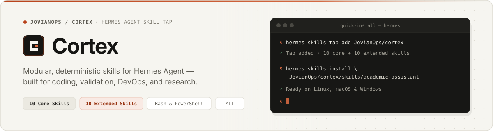

<div align="center">
  <a href="https://github.com/JovianOps/cortex">
    <picture>
      <source media="(prefers-color-scheme: dark)" srcset="assets/banner-dark.svg" />
      <source media="(prefers-color-scheme: light)" srcset="assets/banner-light.svg" />
      
    </picture>
  </a>

  <br />
  <br />

  <p>
    <a href="https://github.com/JovianOps/cortex/actions/workflows/ci.yml">
      
    </a>
    <a href="#core-skills">
      
    </a>
    <a href="#extended-skills">
      
    </a>
    <a href="#requirements">
      
    </a>
    <a href="LICENSE">
      
    </a>
  </p>

  <p>
    <a href="#quick-start">Quick Start</a>
    &nbsp;&middot;&nbsp;
    <a href="#core-skills">Core Skills</a>
    &nbsp;&middot;&nbsp;
    <a href="#extended-skills">Extended Skills</a>
    &nbsp;&middot;&nbsp;
    <a href="#installation">Installation</a>
    &nbsp;&middot;&nbsp;
    <a href="#repository-structure">Structure</a>
    &nbsp;&middot;&nbsp;
    <a href="#validation-packaging--benchmarks">Development</a>
    &nbsp;&middot;&nbsp;
    <a href="CONTRIBUTING.md">Contributing</a>
  </p>
</div>

---

**Cortex** is a curated skill tap of **20 modular, deterministic skills** for **Hermes Agent** — organized into **10 core skills** (`skills/`) for academic, coding, validation, and 3D workflows, and **10 extended engineering skills** (`premium-skills/`) for APIs, databases, DevOps, security, and testing.

Every skill ships with standardized YAML frontmatter, cross-platform native shell install instructions (no `jq` or `xargs` required), and verified one-file ZIP distributions.

## Quick Start

Register the Cortex tap once, then install any skill by collection and name:

```bash
hermes skills tap add JovianOps/cortex
hermes skills install JovianOps/cortex/skills/academic-assistant --yes
```

> [!TIP]
> Prefer a visual picker? Open [`index.html`](index.html) locally or via GitHub Pages to filter all 20 skills and assemble a custom Bash or PowerShell install command with one click.

## Core Skills

Ten foundational skills located in [`skills/`](skills/) with prebuilt archives in [`zips/`](zips/).

| Skill | Focus | Description | Spec |
| :--- | :--- | :--- | :---: |
| **[academic-assistant](skills/academic-assistant)** | Academic & Multi-Domain | Core academic assistant for coding, report cards, 3D modeling, anti-hallucination, and persistent memory | [`SKILL.md`](skills/academic-assistant/SKILL.md) |
| **[anti-hallucination](skills/anti-hallucination)** | Verification | Validation framework, fact-checking, and anti-hallucination safeguards for AI outputs | [`SKILL.md`](skills/anti-hallucination/SKILL.md) |
| **[blender-3d-modeling](skills/blender-3d-modeling)** | 3D & Graphics | Blender 3D modeling guidance with model integrity checks and step-by-step workflows | [`SKILL.md`](skills/blender-3d-modeling/SKILL.md) |
| **[code-review-assistant](skills/code-review-assistant)** | Code Quality | Automated code review with anti-hallucination checks, style enforcement, and deterministic validation | [`SKILL.md`](skills/code-review-assistant/SKILL.md) |
| **[college-report-card](skills/college-report-card)** | Education | Deterministic college report card generator from structured CSV/JSON grade data | [`SKILL.md`](skills/college-report-card/SKILL.md) |
| **[documentation-generator](skills/documentation-generator)** | Documentation | Automated API docs, READMEs, architecture diagrams, and changelogs from code and specs | [`SKILL.md`](skills/documentation-generator/SKILL.md) |
| **[memory-manager](skills/memory-manager)** | Context | Persistent memory and task-state management across sessions with anti-forgetting measures | [`SKILL.md`](skills/memory-manager/SKILL.md) |
| **[python-coding-assistant](skills/python-coding-assistant)** | Python | Python development assistance with validation, type hints, and anti-hallucination checks | [`SKILL.md`](skills/python-coding-assistant/SKILL.md) |
| **[testing-automation](skills/testing-automation)** | Testing | Automated test suites with `pytest`, coverage enforcement, and CI/CD integration | [`SKILL.md`](skills/testing-automation/SKILL.md) |
| **[web-scraper](skills/web-scraper)** | Data Extraction | Structured web scraping with output validation, rate limiting, and anti-hallucination extraction | [`SKILL.md`](skills/web-scraper/SKILL.md) |

## Extended Skills

Ten specialized software engineering and infrastructure skills located in [`premium-skills/`](premium-skills/) with prebuilt archives in [`premium-zips/`](premium-zips/).

| Skill | Focus | Description | Spec |
| :--- | :--- | :--- | :---: |
| **[api-designer](premium-skills/api-designer)** | Architecture | Design and validate REST/GraphQL APIs from OpenAPI/SDL specifications with contract testing | [`SKILL.md`](premium-skills/api-designer/SKILL.md) |
| **[code-migration](premium-skills/code-migration)** | Modernization | Migrate code across languages, frameworks, or major versions with strict behavior preservation | [`SKILL.md`](premium-skills/code-migration/SKILL.md) |
| **[db-optimizer](premium-skills/db-optimizer)** | Databases | Analyze SQL queries, suggest indexes, resolve N+1 queries, and eliminate performance bottlenecks | [`SKILL.md`](premium-skills/db-optimizer/SKILL.md) |
| **[devops-pipeline](premium-skills/devops-pipeline)** | CI/CD | Generate, validate, and optimize pipelines for GitHub Actions, GitLab CI, and CircleCI | [`SKILL.md`](premium-skills/devops-pipeline/SKILL.md) |
| **[docker-generator](premium-skills/docker-generator)** | Containers | Generate optimized multi-stage Dockerfiles, `docker-compose` setups, and container configs | [`SKILL.md`](premium-skills/docker-generator/SKILL.md) |
| **[performance-profiler](premium-skills/performance-profiler)** | Performance | Profile and optimize CPU, memory, and I/O bottlenecks across applications | [`SKILL.md`](premium-skills/performance-profiler/SKILL.md) |
| **[refactoring-assistant](premium-skills/refactoring-assistant)** | Maintainability | Refactor complex codebases to reduce complexity and apply design patterns safely | [`SKILL.md`](premium-skills/refactoring-assistant/SKILL.md) |
| **[security-auditor](premium-skills/security-auditor)** | Security | Audit code for OWASP vulnerabilities, hardcoded secrets, and compliance issues | [`SKILL.md`](premium-skills/security-auditor/SKILL.md) |
| **[terraform-generator](premium-skills/terraform-generator)** | Infrastructure | Generate and validate Terraform / OpenTofu infrastructure-as-code modules | [`SKILL.md`](premium-skills/terraform-generator/SKILL.md) |
| **[unit-test-generator](premium-skills/unit-test-generator)** | Testing | Generate comprehensive unit tests, edge cases, and regression suites with coverage analysis | [`SKILL.md`](premium-skills/unit-test-generator/SKILL.md) |

## Installation

Install the core collection, the extended collection, or individual skills. All commands use native shell syntax — no `jq` or `xargs` required.

> [!IMPORTANT]
> On **Windows**, use the **PowerShell** commands (`ForEach-Object`) below. Do not paste Bash `for ...; do ... done` loops into PowerShell.

### Install a Single Skill

Add the tap once, then target either `skills/<name>` (core) or `premium-skills/<name>` (extended). Works in both Bash and PowerShell:

```bash
hermes skills tap add JovianOps/cortex
hermes skills install JovianOps/cortex/skills/academic-assistant --yes
```

```bash
# Example extended skill
hermes skills install JovianOps/cortex/premium-skills/security-auditor --yes
```

### Install All 10 Core Skills

<details open>
<summary><strong>Windows — PowerShell (recommended)</strong></summary>

```powershell
hermes skills tap add JovianOps/cortex; 'academic-assistant','college-report-card','anti-hallucination','blender-3d-modeling','code-review-assistant','documentation-generator','memory-manager','python-coding-assistant','testing-automation','web-scraper' | ForEach-Object { hermes skills install "JovianOps/cortex/skills/$_" --yes }
```

</details>

<details open>
<summary><strong>Linux / macOS — Bash</strong></summary>

```bash
hermes skills tap add JovianOps/cortex
for skill in academic-assistant college-report-card anti-hallucination blender-3d-modeling code-review-assistant documentation-generator memory-manager python-coding-assistant testing-automation web-scraper; do
  hermes skills install "JovianOps/cortex/skills/$skill" --yes
done
```

</details>

### Install All 10 Extended Skills

<details>
<summary><strong>Windows — PowerShell</strong></summary>

```powershell
hermes skills tap add JovianOps/cortex; 'api-designer','code-migration','db-optimizer','devops-pipeline','docker-generator','performance-profiler','refactoring-assistant','security-auditor','terraform-generator','unit-test-generator' | ForEach-Object { hermes skills install "JovianOps/cortex/premium-skills/$_" --yes }
```

</details>

<details>
<summary><strong>Linux / macOS — Bash</strong></summary>

```bash
hermes skills tap add JovianOps/cortex
for skill in api-designer code-migration db-optimizer devops-pipeline docker-generator performance-profiler refactoring-assistant security-auditor terraform-generator unit-test-generator; do
  hermes skills install "JovianOps/cortex/premium-skills/$skill" --yes
done
```

</details>

## Requirements

| Dependency | Requirement | Notes |
| :--- | :--- | :--- |
| **Hermes Agent** | Required | Provides the `hermes skills` tap and installation CLI |
| **PowerShell 5.1+ / 7+ or Bash** | Required | Native shell support for Windows, Linux, and macOS |
| **Python 3** | Optional | Used for PDF export in `college-report-card` and local skill validation scripts |

## Repository Structure

```text
cortex/
├── assets/                 # Adaptive light & dark SVG branding assets
├── skills/                 # 10 core Hermes skills (each with SKILL.md)
├── premium-skills/         # 10 extended engineering skills (each with SKILL.md)
├── zips/                   # Verified one-file ZIP distributions for core skills
├── premium-zips/           # Verified one-file ZIP distributions for extended skills
├── evals/
│   └── skill_evals.json    # 20 paired 100-point Without-Skill vs. With-Skill rubrics
├── scripts/
│   ├── package_skills.py   # Build or verify skill ZIP archives
│   ├── validate_skills.py  # Validate skill frontmatter, sections & ZIP parity
│   ├── validate_yaml.py    # Validate all YAML configuration files
│   └── eval_skills.py      # Audit skill quality & score Without vs. With Skill runs
├── .github/                # CI workflows, Dependabot & issue/PR templates
├── index.html              # Interactive catalog & custom install command builder
├── CONTRIBUTING.md         # Authoring standards and contribution workflow
└── LICENSE                 # MIT License
```

## Validation, Packaging & Benchmarks

Before opening a pull request, regenerate ZIP archives if you edited any `SKILL.md` and run the repository checks:

```bash
# Rebuild ZIP archives after modifying a SKILL.md
python scripts/package_skills.py

# Verify ZIP parity and validate all 20 skills
npm test
```

You can also run the validation and benchmark scripts directly:

```bash
python scripts/package_skills.py --check
python scripts/validate_skills.py
python scripts/validate_yaml.py

# Audit playbook quality across all 20 skills & validate eval rubrics
python scripts/eval_skills.py

# Export paired A/B prompts or score saved Without-Skill vs. With-Skill outputs
python scripts/eval_skills.py --export-prompts /tmp/paired_prompts.json
python scripts/eval_skills.py --score ./runs/without-skill ./runs/with-skill
```

## Contributing

Contributions and new skills are welcome! Read the **[Contributing Guide](CONTRIBUTING.md)** for the `SKILL.md` frontmatter schema, authoring standards, and pull request checklist.

## License

Released under the **MIT License** — see [`LICENSE`](LICENSE) for details.
